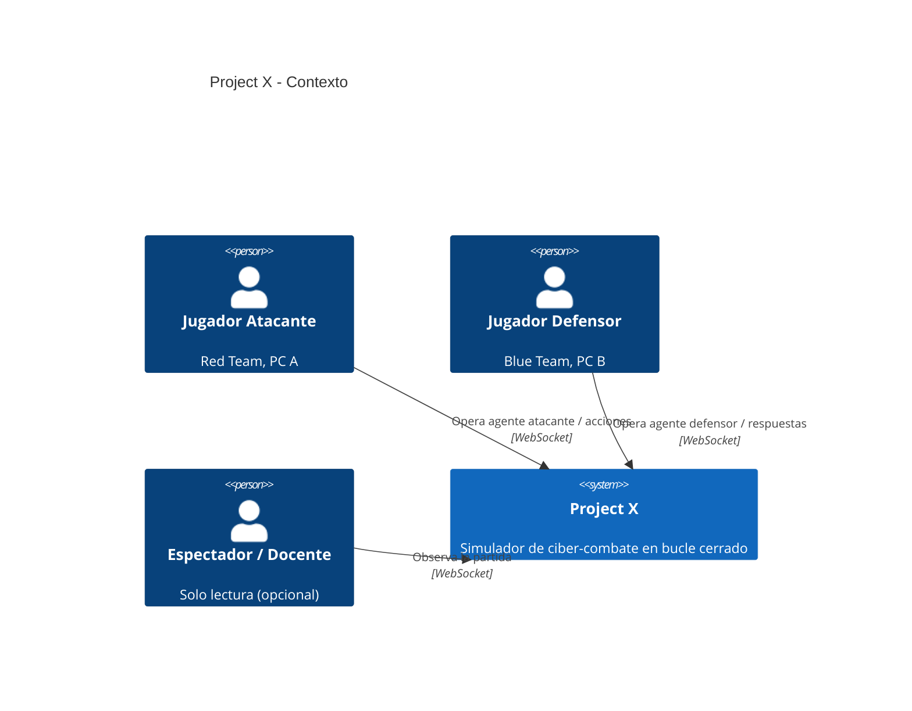
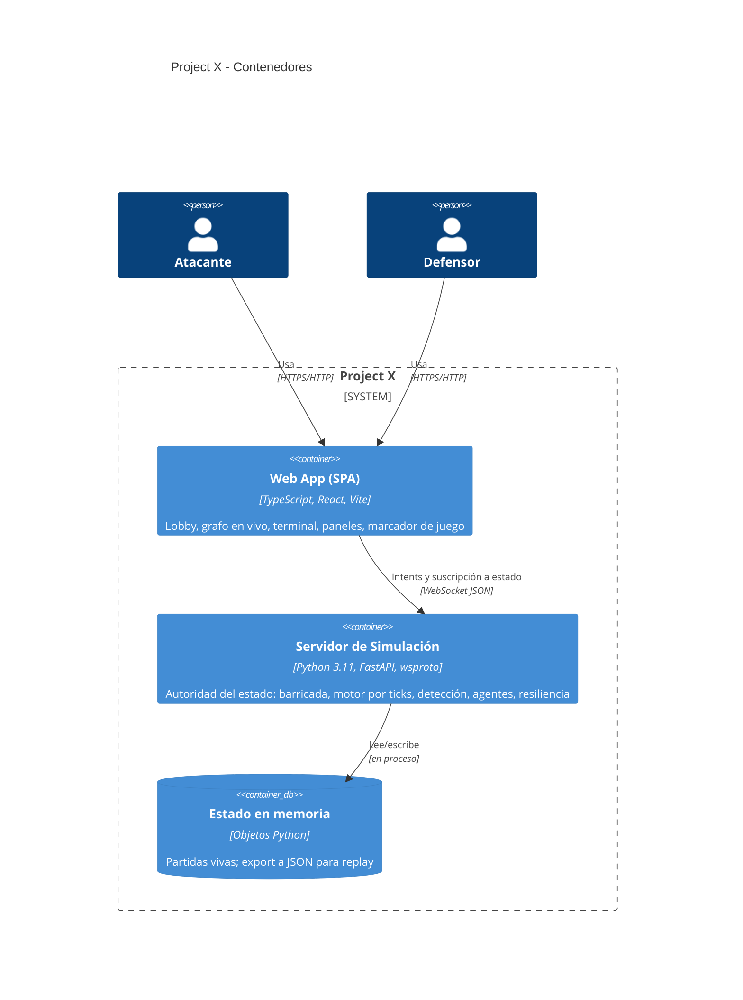
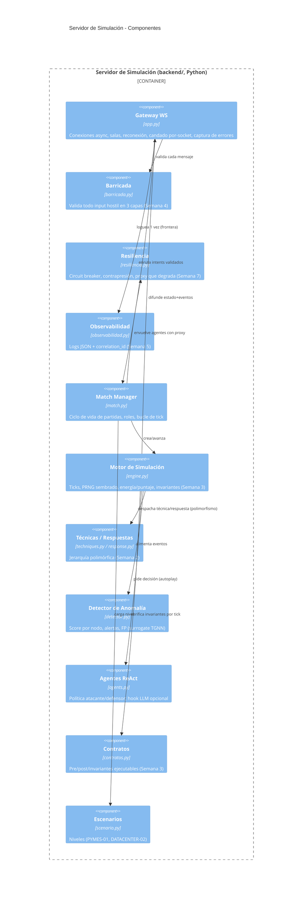
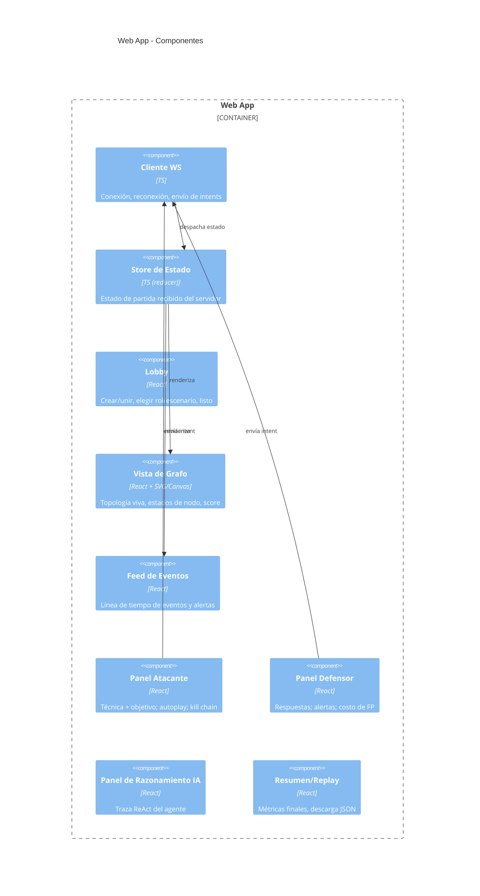
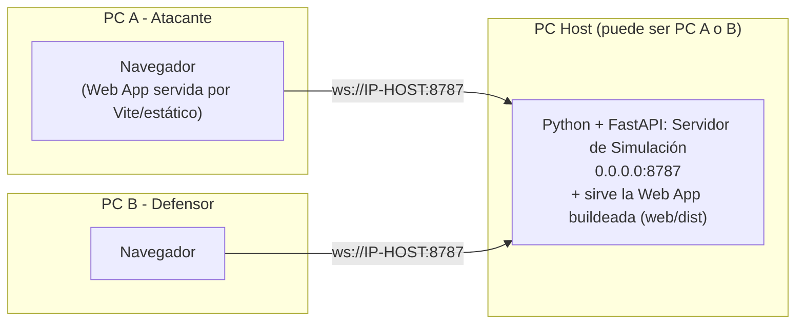

# Project X — Arquitectura (modelo C4)

Diagramas en Mermaid (se renderizan en GitHub/VS Code). Cuatro niveles: Contexto, Contenedores, Componentes, y despliegue en LAN.

## Nivel 1 — Contexto

## Nivel 2 — Contenedores

## Nivel 3 — Componentes del Servidor

## Nivel 3 — Componentes de la Web App

## Nivel 4 — Despliegue (LAN del laboratorio)

> **Nota de despliegue:** en producción de clase, el servidor FastAPI también sirve el build estático de la web (`web/dist`), así ambas PCs solo necesitan `http://IP-HOST:8787`. En desarrollo, Vite corre aparte en :5174 y el servidor en :8787.
