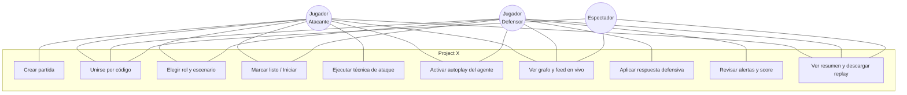
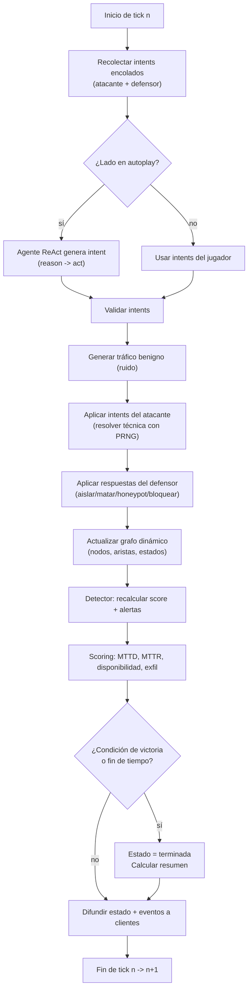
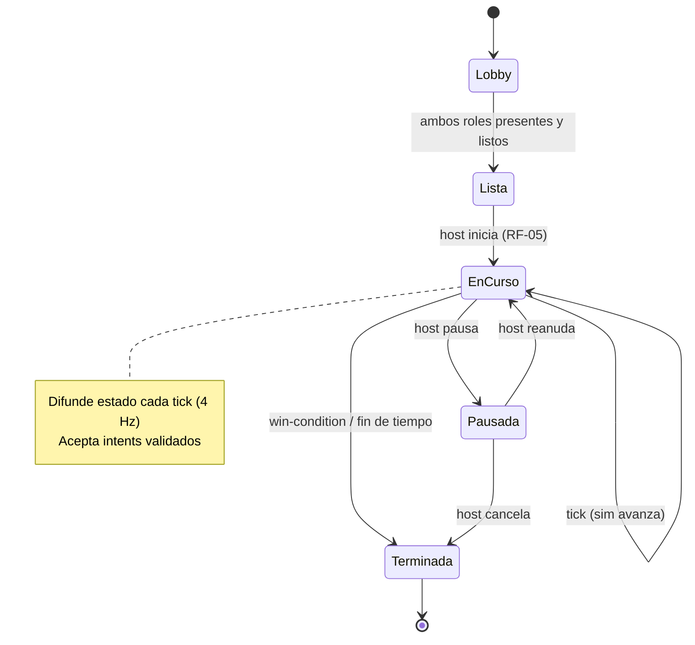
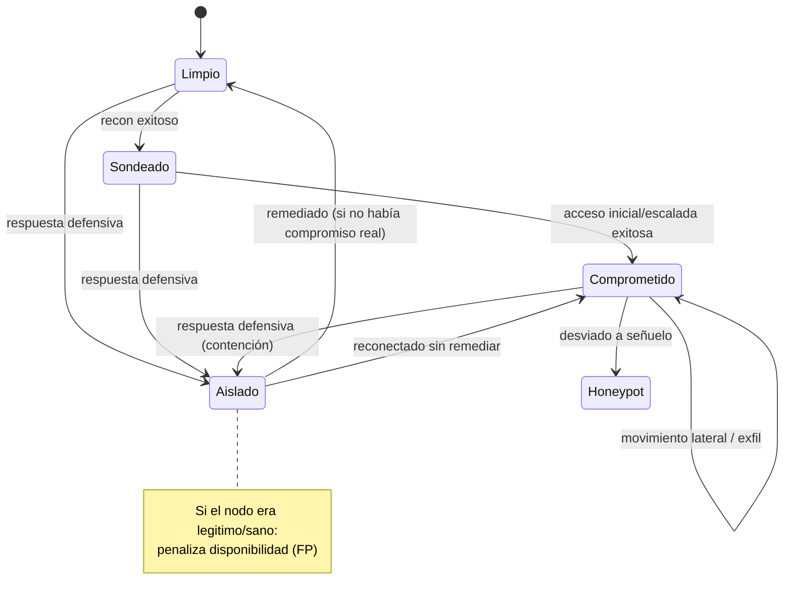
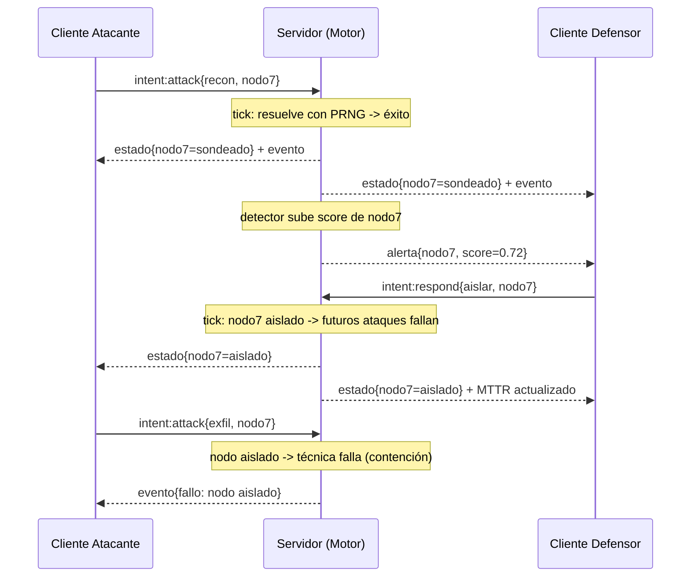
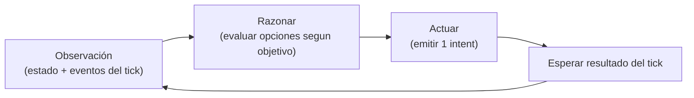

# Project X — Diagramas (casos de uso, flujo, estados, secuencia)

## 1. Casos de uso

### Caso de uso detallado: UC5 — Ejecutar técnica de ataque
- **Actor:** Jugador Atacante (o Agente Atacante en autoplay).
- **Precondición:** partida en estado *en curso*; es el lado atacante quien actúa.
- **Flujo principal:**
  1. El atacante selecciona un **nodo objetivo** y una **técnica** aplicable.
  2. El cliente envía `intent:attack{tecnica, nodoId}`.
  3. El servidor valida (técnica aplicable al estado/servicio del nodo).
  4. En el siguiente tick, resuelve éxito/fallo (vuln del nodo × postura defensiva × PRNG).
  5. Genera eventos; actualiza estado de compromiso y métricas; difunde.
- **Flujos alternativos:** 3a técnica no aplicable → error de validación; 4a defensor tenía el nodo aislado → la técnica falla por contención.
- **Postcondición:** el nodo puede avanzar en la kill chain; el defensor ve nuevos eventos y posible alerta.

### Caso de uso detallado: UC8 — Aplicar respuesta defensiva
- **Actor:** Jugador/Agente Defensor.
- **Precondición:** partida *en curso*.
- **Flujo principal:** elige respuesta (aislar/matar/honeypot/bloquear IP) y objetivo → `intent:respond{...}` → el servidor la aplica en el tick → cambia estado y afecta al atacante.
- **Regla de costo:** si el objetivo era legítimo (sin compromiso real), baja la **disponibilidad** (falso positivo penalizado — RF-33).

## 2. Diagrama de flujo — resolución de un tick

## 3. Diagrama de estados — Partida

## 4. Diagrama de estados — Nodo de la red

## 5. Diagrama de secuencia — enfrentamiento típico

## 6. Ciclo de vida del agente ReAct (atacante o defensor)

